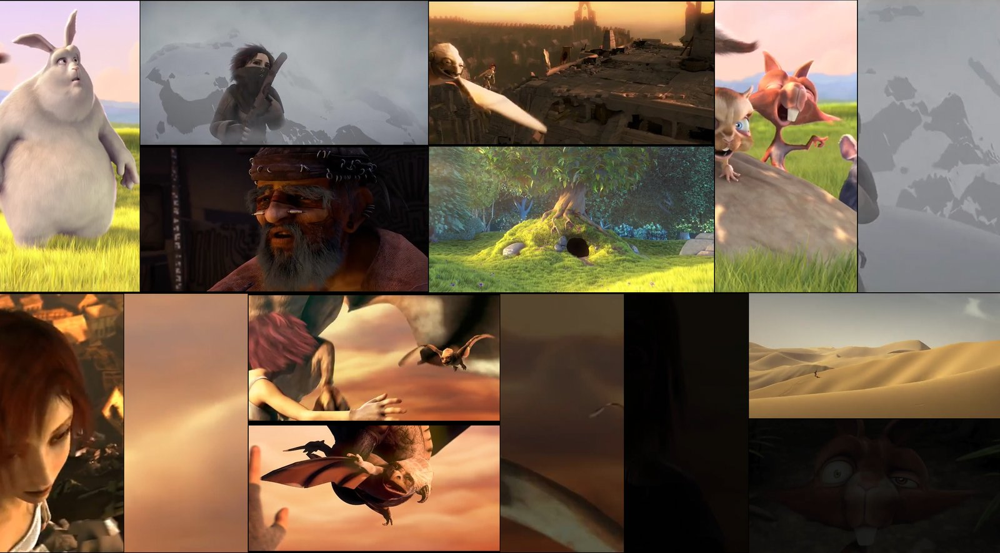
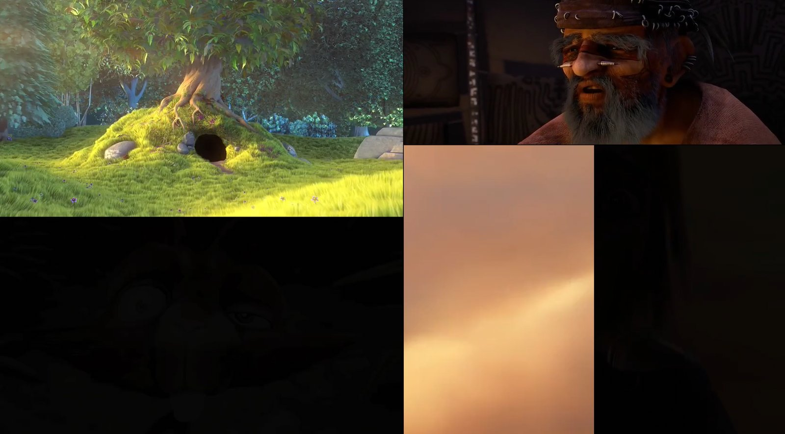
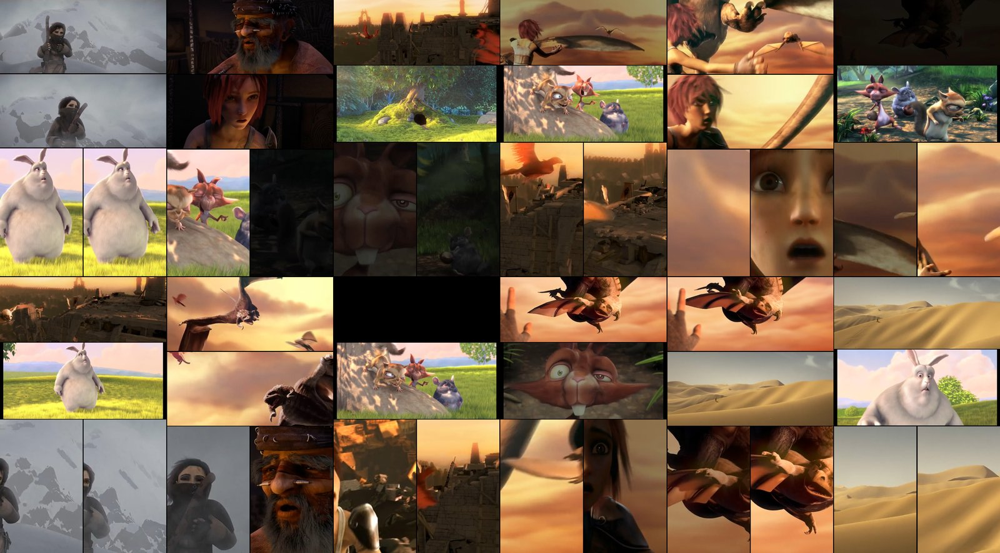
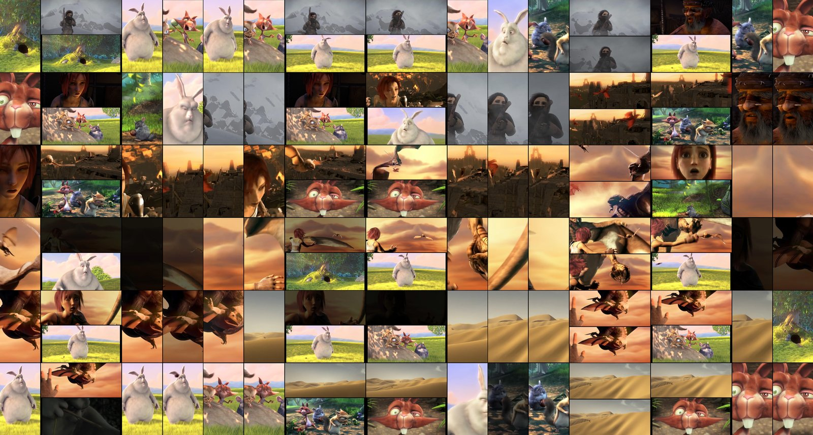

<h1 align="center">
  <br>
  MosaicPlayer: multi video player
</h1>

<p align="center"><b>Play multiple videos at the same time, packed like a puzzle to fill your screen.</b><br>
A free video wall and split-screen video player for Windows and Linux. A fast GridPlayer alternative.</p>

<p align="center">
  <a href="https://github.com/itsui/mosaicplayer/releases/latest"></a>
  
  <a href="LICENSE"></a>
</p>



Watch dozens of videos at once, side by side: open a folder and MosaicPlayer
arranges every clip, portrait and landscape mixed, into a video mosaic that
fills the screen, with a similar size for each video. No rows and columns to
set up.

Inspired by [GridPlayer](https://github.com/vzhd1701/gridplayer), MosaicPlayer
plays far more videos at once without stuttering: 60 or more, even in 4K
or at 60 fps.

**[⬇ Download for Windows or Linux](https://github.com/itsui/mosaicplayer/releases/latest)**

## Features

- **Many videos, smooth playback.** 60+ videos at once on a regular gaming
  PC, using the graphics card where it helps.
- **Automatic puzzle layout.** Vertical (phone) and horizontal videos fit
  together with almost no gaps. Choose equal sizes, balanced, or fill every
  pixel, or switch to rows, columns or a classic grid.
- **Make any video bigger or smaller.** The others move around it.
- **Drag to swap, double-click to focus** one video full screen, then come
  back to the exact same arrangement.
- **Random start times** so similar videos don't play in sync, or **sync
  them all** to one video.
- **Loop, next file in the folder, or a random file** when a video ends.
- **Playlists** that remember positions, sizes and the layout. Opens
  GridPlayer `.gpls` and VLC `.m3u` playlists.
- **Free and open source.** No ads, no account, works offline.

## Use it for

- a **video wall** or **multiview** screen on a second monitor or TV
- watching a **folder of clips** at once instead of one by one
- **comparing** takes, angles or edits side by side, in sync
- **reference and practice** videos (dance, sports, music) playing together
- background visuals for parties, streams or shop windows

## Smooth with 5 videos or 50

| | |
|---|---|
|  |  |
| **5 videos:** every video at its full 24 fps, screen redrawn 60 times a second | **15 videos:** full 24 fps each, 60 redraws a second |
|  |  |
| **48 videos:** still full 24 fps each, 60 redraws a second | **120 videos, just for fun:** it still plays (about 22 of 24 fps each), but the screen redraws less often, so this is past the comfortable limit |

Measured on an Intel Core i9-12900KF with an RTX 3090, using 480p–720p clips at
24 fps. Up to about 60 videos stay perfectly smooth on a PC like this.

## Download and install

**Windows 10 and 11:** download `MosaicPlayer-…-windows-setup.exe` from the
[latest release](https://github.com/itsui/mosaicplayer/releases/latest) and
run it. Or take the portable `.zip`, unpack it and run `MosaicPlayer.exe`.
Windows may say the publisher is unknown: click *More info → Run anyway*.

**Linux:** download `MosaicPlayer-…-x86_64.AppImage`, then make it executable
and run it (Ubuntu 24.04, Linux Mint 22, Fedora 40 or newer):

```bash
chmod +x MosaicPlayer-*-x86_64.AppImage
./MosaicPlayer-*-x86_64.AppImage
```

Prefer to run it from source? See the [technical notes](docs/TECHNICAL.md).

## How to use

1. Drag videos or a whole folder onto the window (or press **Ctrl+O**).
2. Press **1–5** to switch layouts, **B** for equal or fill-the-screen sizes.
3. Point at a video and press **+** or **−** to resize it, or drag it onto
   another to swap them.
4. Press **Ctrl+S** to save everything as a playlist.

Right-click anywhere for all options.

<details>
<summary><b>All keyboard and mouse shortcuts</b></summary>

| | |
|---|---|
| Click / double-click | pause one video / show it full screen |
| Middle-click | mute or unmute one video |
| Mouse wheel, ← → | jump 5 s back or forward (Shift: 30 s) |
| Ctrl+wheel, Z | zoom into a video, reset zoom |
| Drag a video onto another | swap them |
| +, −, 0, Alt+wheel | bigger, smaller, normal size |
| Space, M | pause all, mute all |
| S, Y, Home | random times, sync all to this video, restart all |
| N, Del | random video from the same folder, remove |
| 1–5, B, R, C, [ ] | layout, tile sizes, reshuffle, crop, gap |
| F or F11, T, Ctrl+M, H | fullscreen, stay on top, menu bar, stats |
| Ctrl+O, Ctrl+Shift+O, Ctrl+U, Ctrl+L | open videos, folder, web address, playlist |
| Ctrl+N, Ctrl+S, Ctrl+Shift+S | new, save playlist, save as |
| Ctrl+, , F1 | settings, help |

</details>

## MosaicPlayer and GridPlayer

[GridPlayer](https://github.com/vzhd1701/gridplayer) is a great app and the
inspiration for this one. MosaicPlayer focuses on large, mixed collections:

| | GridPlayer | MosaicPlayer |
|---|---|---|
| Many videos at once | stutters on 30+ videos | smooth with 60+ |
| Layout | grid, rows and columns set by hand | automatic puzzle, rows, columns or grid |
| Portrait and landscape mixed | leaves big gaps | fills the screen |
| Resize one video | no | yes |
| `.gpls` playlists | yes | yes, both ways |
| Systems | Windows, Linux, macOS | Windows, Linux |

Measured with 32 videos on the same PC: smooth playback, 1.2 GB of memory
instead of about 3 GB, and 97% of the screen used instead of 63%
([details](docs/TECHNICAL.md#whats-different-from-gridplayer)).

## FAQ

### How do I play multiple videos at the same time on Windows or Linux?

Install MosaicPlayer, then drop a folder of videos onto its window. All of
them play at once, arranged to fill the screen.

### Can I make a video wall or video mosaic for a second screen?

Yes. Move the window to that screen and press **F** for fullscreen. **T**
keeps it on top of other windows.

### Does it work with vertical videos (phone, TikTok, Shorts, Reels)?

Yes. Vertical and horizontal videos are fitted together automatically.

### Which formats does it play?

Nearly everything: MP4, MKV, WebM, MOV, AVI, WMV, GIF and more, plus web
addresses (with [yt-dlp](https://github.com/yt-dlp/yt-dlp) installed).

### Do I need a powerful computer?

No. A few HD videos play on any recent PC. Dozens of HD videos or several 4K
videos at once need a modern processor or graphics card.

### Is it a GridPlayer fork?

No. MosaicPlayer is a separate app written from scratch, inspired by
GridPlayer. It opens and saves the same `.gpls` playlists, so you can use both.

### Is it free? Does it collect data?

It's free and open source. It doesn't collect or send anything; it only goes
online for web addresses you open and when you choose *Help → Check for
updates*.

## Help and feedback

Found a bug or have an idea? [Open an issue](https://github.com/itsui/mosaicplayer/issues).
*Help → Open log folder* has a log file you can attach.

## License

Free software under the [GPL-3.0](LICENSE). Uses [mpv](https://mpv.io) and
Qt; see [third-party notices](THIRD-PARTY-NOTICES.md). Screenshots show
[Big Buck Bunny](https://peach.blender.org) and [Sintel](https://durian.blender.org)
© Blender Foundation, [CC BY 3.0](https://creativecommons.org/licenses/by/3.0/).
